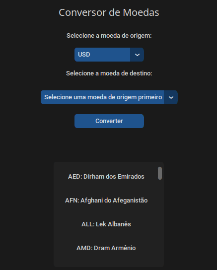
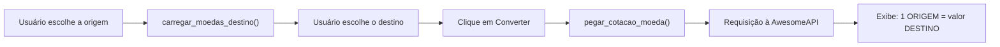

# Conversor de Moedas


Aplicação desktop em **Python** que consulta a cotação entre duas moedas na **AwesomeAPI** e exibe o resultado em uma interface gráfica escura, construída com **CustomTkinter**.

## Sumário

- [Sobre o projeto](#sobre-o-projeto)
- [Funcionalidades](#funcionalidades)
- [Captura de tela](#captura-de-tela)
- [Tecnologias utilizadas](#tecnologias-utilizadas)
- [Requisitos e dependências](#requisitos-e-dependências)
- [Instalação no Ubuntu Linux](#instalação-no-ubuntu-linux)
- [Configuração do ambiente virtual](#configuração-do-ambiente-virtual)
- [Como executar](#como-executar)
- [Estrutura de diretórios](#estrutura-de-diretórios)
- [Principais módulos](#principais-módulos)
- [Tratamento de erros e limitações conhecidas](#tratamento-de-erros-e-limitações-conhecidas)
- [Autor](#autor)

## Sobre o projeto

O **Conversor de Moedas** foi desenvolvido para consultar, de forma simples, a cotação entre duas moedas. O usuário escolhe a **moeda de origem** e a **moeda de destino**, clica em **Converter** e a aplicação busca a cotação atual na [AwesomeAPI](https://docs.awesomeapi.com.br/), uma API pública de cotações em tempo real.

**Objetivos do projeto:**

- Praticar o consumo de uma API REST com a biblioteca `requests`.
- Ler e organizar dados estáticos em XML com `xmltodict`.
- Construir uma interface gráfica desktop com `customtkinter`.
- Organizar o código em módulos com responsabilidades separadas.

## Funcionalidades

- **Seleção da moeda de origem** em uma lista com todas as origens disponíveis (78 no arquivo `conversoes.xml`).
- **Destinos dinâmicos:** ao escolher a origem, a lista de destino é atualizada apenas com as moedas para as quais existe cotação.
- **Consulta da cotação** na AwesomeAPI ao clicar em **Converter**.
- **Exibição do resultado** no formato `1 USD = <cotação> BRL`, usando o valor de compra (campo `bid`) retornado pela API.
- **Lista de consulta rolável** com o código e o nome de cada moeda e ativo (162 itens, incluindo criptomoedas e metais), em português.
- **Tema escuro** com o tema de cores `dark-blue` e janela de 450x550 pixels.

## Captura de tela



*Tela inicial da aplicação, com os seletores de origem e destino, o botão Converter e a lista de moedas.*

## Tecnologias utilizadas

| Tecnologia | Versão | Uso no projeto |
|---|---|---|
| **Python** | 3.14.4 (ambiente de desenvolvimento) | Linguagem principal |
| **CustomTkinter** | 6.0.0 | Interface gráfica (janela, menus, botão e lista rolável) |
| **Requests** | 2.34.2 | Requisições HTTP à AwesomeAPI |
| **xmltodict** | 1.0.4 | Leitura dos arquivos `moedas.xml` e `conversoes.xml` |
| **AwesomeAPI** | — | Fonte das cotações |
| **Git e GitHub** | — | Versionamento e hospedagem do código |

## Requisitos e dependências

### Requisitos do sistema

| Item | Pacote no Ubuntu | Observação |
|---|---|---|
| Python 3 | `python3` | O projeto foi desenvolvido com a versão 3.14.4 |
| Módulo `venv` | `python3-venv` | Criação do ambiente virtual |
| Gerenciador `pip` | `python3-pip` | Instalação das bibliotecas |
| Tkinter | `python3-tk` | Necessário para qualquer janela gráfica em Python |
| Git | `git` | Clonar o repositório |
| Conexão com a internet | — | Necessária para consultar a cotação |

### Dependências Python

As bibliotecas usadas diretamente pelo código são `customtkinter`, `requests` e `xmltodict`. O arquivo `requirements.txt` também fixa pacotes de apoio, instalados automaticamente (por exemplo `certifi`, `urllib3`, `idna`, `charset-normalizer`, `darkdetect`, `packaging`, `pillow`, `setuptools` e `wheel`).

> **Atenção:** as versões do `requirements.txt` foram geradas em um ambiente com Python 3.14.4. Em versões diferentes do Python, a instalação pode exigir ajustes.

## Instalação no Ubuntu Linux

**1. Atualize os pacotes e instale os requisitos do sistema:**

```bash
sudo apt update
sudo apt install -y git python3 python3-venv python3-pip python3-tk
```

**2. Confirme a versão do Python e o funcionamento do Tkinter:**

```bash
python3 --version
python3 -m tkinter
```

O segundo comando deve abrir uma pequena janela de teste do Tkinter. Se aparecer `No module named 'tkinter'`, o pacote `python3-tk` não foi instalado.

**3. Clone o repositório e entre na pasta do projeto:**

```bash
git clone https://github.com/gabrielsantiago703/Projeto_conversor_de_moedas.git
cd Projeto_conversor_de_moedas
```

## Configuração do ambiente virtual

Um **ambiente virtual** isola as bibliotecas do projeto das bibliotecas do sistema. Neste projeto ele se chama `ambiente-dev` e já está listado no `.gitignore`, portanto não é enviado ao GitHub.

**1. Crie o ambiente virtual** (dentro da pasta do projeto):

```bash
python3 -m venv ambiente-dev
```

**2. Ative o ambiente:**

```bash
source ambiente-dev/bin/activate
```

O terminal passa a exibir `(ambiente-dev)` no início da linha.

**3. Instale as dependências:**

```bash
pip install -r requirements.txt
```

**4. Para sair do ambiente virtual quando terminar:**

```bash
deactivate
```

## Como executar

Com o ambiente virtual **ativado** e o terminal aberto na **raiz do projeto**, execute:

```bash
python main.py
```

> **Importante:** execute o comando a partir da pasta do projeto. Os arquivos `moedas.xml` e `conversoes.xml` são abertos por caminho relativo e não serão encontrados se o programa for iniciado de outro diretório.

### Como usar

1. Em **Selecione a moeda de origem**, escolha a moeda desejada.
2. Em **Selecione a moeda de destino**, escolha uma das opções carregadas para essa origem.
3. Clique em **Converter**.
4. A cotação aparece abaixo do botão, no formato `1 ORIGEM = valor DESTINO`.
5. Use a lista rolável no final da janela para consultar o código de cada moeda.

### Fluxo da aplicação



## Estrutura de diretórios

```text
Projeto_conversor_de_moedas/
├── assets/
│   └── screenshot.png      # Captura de tela usada neste README
├── main.py                 # Interface gráfica e ponto de entrada
├── pegar_cotacao.py        # Consulta da cotação na AwesomeAPI
├── pegar_moedas.py         # Leitura dos arquivos XML de moedas e pares
├── moedas.xml              # Código e nome de cada moeda (162 itens)
├── conversoes.xml          # Pares de conversão disponíveis (540 pares)
├── requirements.txt        # Dependências do projeto
├── .gitignore              # Arquivos ignorados pelo Git
└── README.md               # Este documento
```

A pasta `ambiente-dev/` (ambiente virtual) é criada localmente e não faz parte do repositório.

## Principais módulos

### `main.py`

Define o modo escuro e o tema de cores `dark-blue` (`set_appearance_mode()` e `set_default_color_theme()`), cria a janela principal e todos os elementos da interface: título, rótulos, os dois menus de seleção (`CTkOptionMenu`), o botão **Converter**, o rótulo do resultado e a lista rolável de moedas (`CTkScrollableFrame`). Também define duas funções:

- `carregar_moedas_destino(moeda_selecionada)`: chamada quando a origem muda; preenche o menu de destino com as moedas disponíveis e seleciona a primeira.
- `converter_moeda()`: lê origem e destino, chama `pegar_cotacao_moeda()` e atualiza o rótulo com o resultado.

### `pegar_moedas.py`

Lê os arquivos XML com `xmltodict` e devolve dicionários Python:

- `nomes_moedas()`: lê `moedas.xml` e retorna um dicionário `código -> nome` (por exemplo, `"BRL"` para `"Real Brasileiro"`).
- `conversoes_disponiveis()`: lê `conversoes.xml`, separa cada par `ORIGEM-DESTINO` e retorna um dicionário `origem -> [lista de destinos]`.

### `pegar_cotacao.py`

Contém `pegar_cotacao_moeda(moeda_origem, moeda_destino)`, que faz uma requisição `GET` ao endpoint da AwesomeAPI:

```text
https://economia.awesomeapi.com.br/last/{ORIGEM}-{DESTINO}
```

A resposta é um JSON cuja chave principal é a junção dos códigos (por exemplo, `USDBRL`). A função devolve o campo `bid` (valor de compra) dessa chave. Exemplo ilustrativo da estrutura, com valores fictícios:

```json
{
  "USDBRL": {
    "code": "USD",
    "codein": "BRL",
    "bid": "5.0000",
    "ask": "5.0010"
  }
}
```

### `moedas.xml` e `conversoes.xml`

Arquivos de dados estáticos. O primeiro lista os códigos e nomes das moedas; o segundo lista os pares de conversão aceitos (formato `<USD-BRL>Dólar Americano/Real Brasileiro</USD-BRL>`). Eles alimentam os menus e a lista rolável sem necessidade de consultar a API na inicialização.

## Tratamento de erros e limitações conhecidas

### Situação atual do tratamento de erros

O projeto **ainda não possui tratamento explícito de exceções** (`try/except`). Quando algo falha, o Tkinter registra o erro no terminal e a janela continua aberta, mas **nenhuma mensagem é exibida ao usuário**.

| Situação | O que acontece hoje |
|---|---|
| Sem conexão com a internet | `requests` lança `ConnectionError`; o resultado não é atualizado |
| API retorna erro ou não possui o par solicitado | `KeyError` ao ler a chave `{ORIGEM}{DESTINO}` do JSON |
| Rede instável ou lenta | A requisição não tem `timeout` e é síncrona; a janela pode ficar sem responder até a chamada terminar |
| Programa iniciado fora da raiz do projeto | `FileNotFoundError` ao abrir `moedas.xml` ou `conversoes.xml` |

### Limitações conhecidas

- **Cotação unitária:** a aplicação mostra o valor de **1 unidade** da moeda de origem. Ainda não há campo para digitar um valor e converter uma quantia.
- **Destino não carregado na abertura:** a moeda de origem inicial (`USD`) aparece selecionada, mas o menu de destino só é preenchido depois que o usuário escolhe uma origem. Clicar em **Converter** antes disso envia o texto de aviso como código de moeda e gera erro.
- **Dados XML estáticos:** novas moedas ou novos pares disponibilizados pela API só aparecem na aplicação se os arquivos forem atualizados manualmente.
- **Dependência da AwesomeAPI:** o funcionamento depende da disponibilidade do serviço. Consulte os planos e limites de uso em [awesomeapi.com.br](https://awesomeapi.com.br/). O projeto não envia chave de API.
- **Sem testes automatizados** no repositório.

### Próximos passos sugeridos

- Envolver a requisição em `try/except`, definir `timeout` e verificar o código de status da resposta.
- Exibir mensagens de erro na própria interface.
- Carregar os destinos da origem inicial na abertura da janela.
- Adicionar um campo para o valor a converter.
- Executar a requisição em uma thread separada para não travar a janela.

## Autor

**Gabriel Santiago**

- GitHub: [@gabrielsantiago703](https://github.com/gabrielsantiago703)
- Repositório do projeto: [Projeto_conversor_de_moedas](https://github.com/gabrielsantiago703/Projeto_conversor_de_moedas)

## Referências

- [Documentação da AwesomeAPI](https://docs.awesomeapi.com.br/)
- [CustomTkinter no GitHub](https://github.com/TomSchimansky/CustomTkinter)
